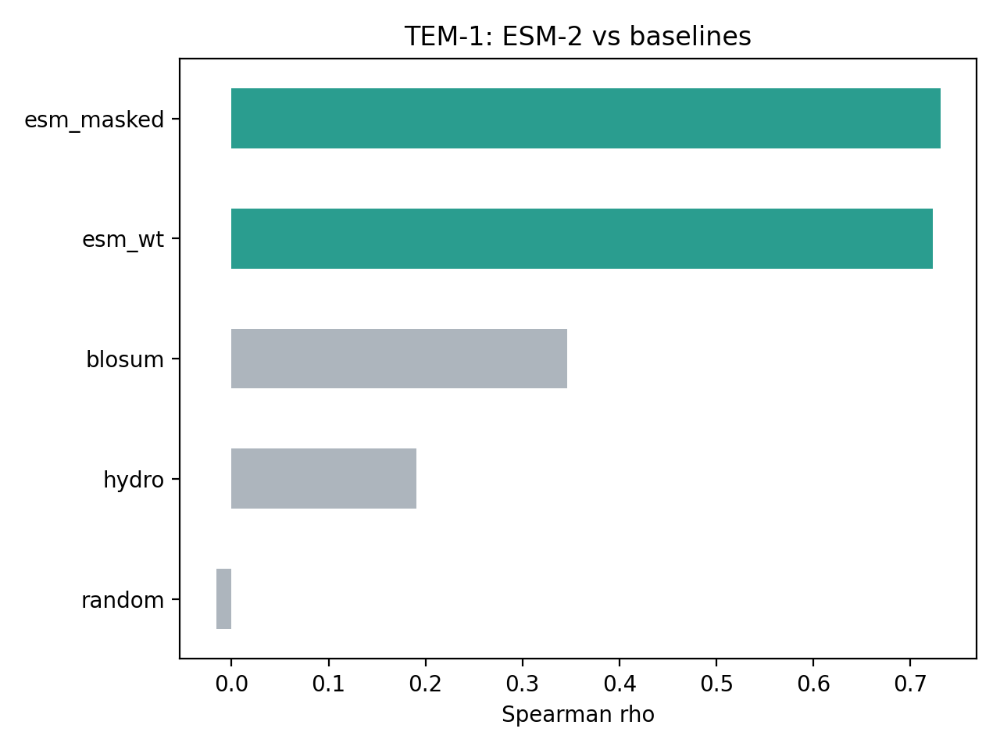
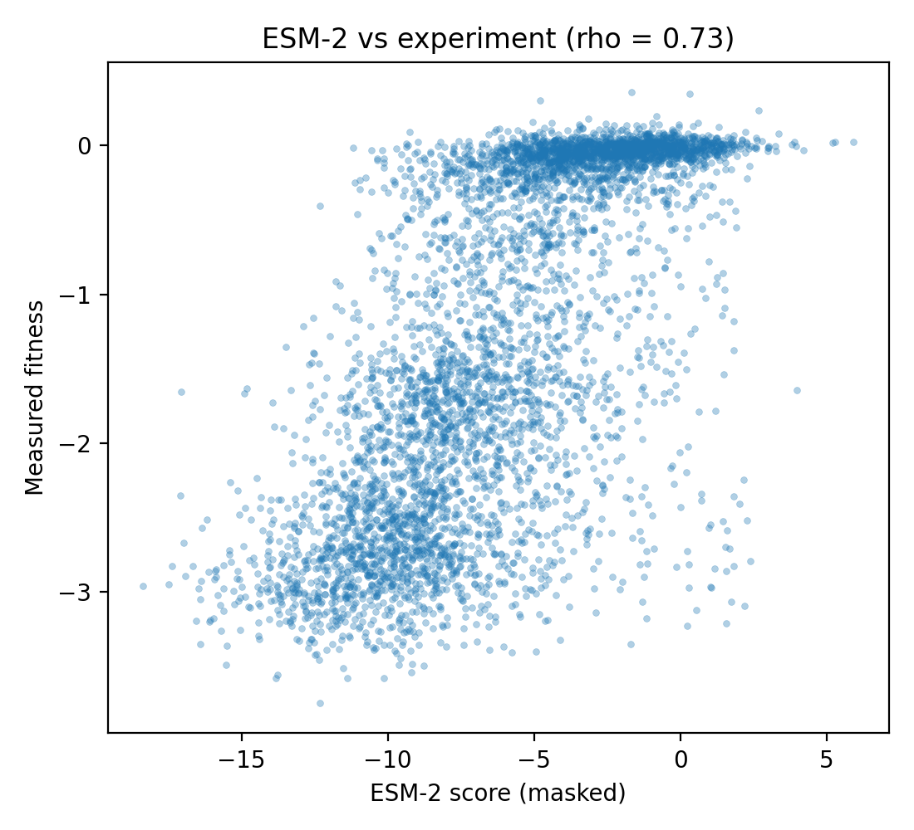
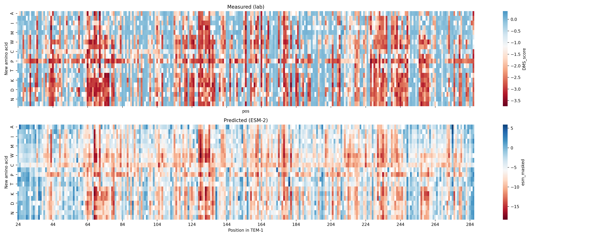
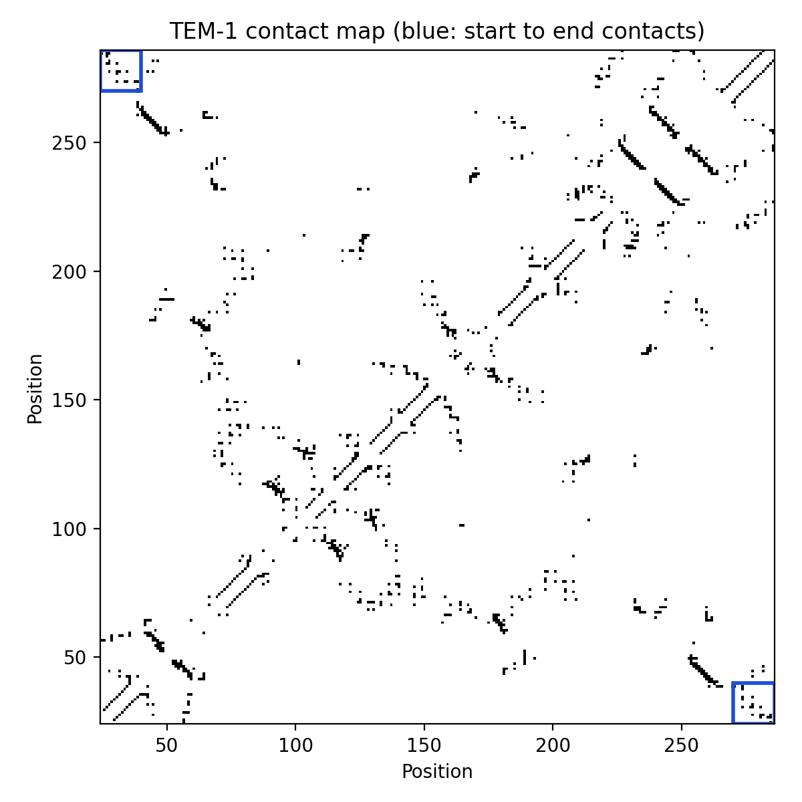

# Zero-shot prediction of mutation effects in TEM-1 β-lactamase with a protein language model

Can a protein language model that has never seen experimental data predict which mutations break an enzyme? And where it fails, why?

This project scores **4,996 single amino-acid substitutions** in TEM-1 β-lactamase with **ESM-2 (650M)**. It compares the scores against deep mutational scanning (DMS) measurements and simple baselines, and then uses the AlphaFold structure to explain where the model goes wrong.

## Key results

- **ESM-2 predicts mutational effects well without any training on lab data:** Spearman ρ = **0.73**, about **2×** the BLOSUM62 baseline (ρ = 0.35).
- **Accuracy depends strongly on position:** ρ = 0.76 in the enzyme core, but only 0.54 and 0.49 at the N- and C-terminal regions. The bootstrap 95% confidence intervals do not overlap.
- **The terminal errors have a structural explanation:** the two termini form a packed α-helix–helix interface, and the worst-predicted residues sit exactly on its contact face.
- **The single worst error (G248) is a fully buried glycine with an unusual backbone angle.** No side chain fits there, so every substitution abolishes function, yet the model predicted these mutations to be neutral.

---

## Background

**Deep mutational scanning (DMS)** experiments measure the functional effect of thousands of mutations in a protein in one go. Here I use the TEM-1 β-lactamase dataset from Stiffler et al. (2015), which measured how well each single mutant still confers ampicillin resistance in *E. coli*.

**Protein language models** such as ESM-2 are trained on millions of natural protein sequences with a masked-token objective. To predict hidden amino acids, the model must learn which residues evolution tolerates at each position. This makes it possible to score mutations **zero-shot**, with no experimental labels at all.

## Data

| Source | What | Notes |
|---|---|---|
| [ProteinGym v1.3](https://proteingym.org) | DMS assay `BLAT_ECOLX_Stiffler_2015` | 4,996 single mutants after filtering out multi-mutants. `DMS_score`: higher = fitter |
| [AlphaFold DB](https://alphafold.ebi.ac.uk/entry/P62593) | Predicted structure of TEM-1 (UniProt P62593) | Same 286-residue sequence as the assay |

Positions use the 1–286 precursor numbering. Residues 1–23 are the signal peptide, which is cleaved off and was not assayed. This numbering differs from the Ambler numbering used in much of the β-lactamase literature.

## Methods

### Scoring with ESM-2
Each mutation is scored as a log-likelihood ratio from `facebook/esm2_t33_650M_UR50D`:

$$\text{score} = \log P(\text{mutant aa}) - \log P(\text{wild-type aa})$$

Two variants:
- **Wild-type marginal:** one forward pass on the unmodified sequence.
- **Masked marginal:** each position is replaced with `<mask>` before scoring, so the model cannot "see" the wild-type residue it is judging.

### Baselines
- **BLOSUM62:** a position-independent substitution score.
- **Hydrophobicity change:** −|ΔKyte-Doolittle|.
- **Random:** Gaussian noise, the zero-skill reference.

### Evaluation
- Spearman ρ between predicted scores and `DMS_score`.
- Per-position rank error: |percentile rank(model) − percentile rank(lab)|, averaged per position.
- Regional analysis, with bootstrap 95% CIs (1,000 resamples).

### Structural analysis (AlphaFold model)
- **Relative solvent accessibility (RSA):** Shrake–Rupley SASA divided by the maximum ASA from Tien et al. (2013). Buried = RSA < 0.25.
- **Backbone φ/ψ angles:** computed with Biopython.
- **Residue contacts:** any heavy atoms within 4.5 Å, |i − j| > 3.

---

## Results

### 1. ESM-2 clearly outperforms simple baselines

| Method | Spearman ρ |
|---|---|
| **ESM-2 masked marginal** | **0.731** |
| ESM-2 wild-type marginal | 0.723 |
| BLOSUM62 | 0.346 |
| Hydrophobicity change | 0.191 |
| Random | −0.016 |

ESM-2 roughly doubles the performance of BLOSUM62. BLOSUM62 assigns the same score to a substitution anywhere in any protein, so the gap reflects how much the model gains from sequence context. Masking gave only a marginal improvement (0.731 vs. 0.723): for TEM-1, the bias from seeing the wild-type residue appears small.




### 2. Accuracy drops sharply at the termini

| Region | Mutants | Spearman ρ | 95% CI | Mean rank error |
|---|---|---|---|---|
| Mature N-terminus (24–40) | 322 | 0.543 | [0.46, 0.62] | 0.224 |
| **Core (41–269)** | **4,351** | **0.764** | **[0.75, 0.78]** | **0.149** |
| C-terminus (270–286) | 323 | 0.485 | [0.40, 0.57] | 0.211 |

The model is about 1.5× less accurate at either end of the enzyme, and the confidence intervals do not overlap. 7 of the 15 worst-predicted positions lie in these terminal regions (27, 30, 31, 34 and 283, 285, 286).



### 3. The termini form a helix–helix interface, and the errors sit on it

In the AlphaFold model (pLDDT > 95 at all poorly predicted positions), both terminal regions are α-helices (φ ≈ −63°, ψ ≈ −40°) packed against each other:

- **44%** of the N-terminal region's long-range contacts are with the C-terminal region. By size alone, the expected share is about 6%, so this is roughly 7× more than chance.
- The contacting N-terminal residues (26, 27, 30, 31, 34, 37, 38) are spaced every 3–4 positions, so they line **one face of the helix**. This is a classic helix–helix packing interface.
- The worst-predicted N-terminal residues (**T27, K30, V31, A34**) are exactly the residues on this contact face.

A plausible interpretation: the model sees less flanking sequence at the termini, and termini are often variable in natural proteins. Together, these may lead it to under-weight the structural role of this interface.



### 4. Errors in both directions

**The model was too optimistic** (predicted neutral, but experimentally destructive):

| Position | Lab fitness | ESM-2 score | Structure |
|---|---|---|---|
| G248 | −2.72 | +0.48 | Fully buried (RSA 0.00), φ = +171° |
| W286 | −2.45 | +0.44 | C-terminal residue, partly buried (RSA 0.29) |

G248 is the worst-predicted position. It is a buried glycine in an unusual backbone conformation, a positive φ angle near the limit of what non-glycine residues can adopt. No side chain can be accommodated there, so every substitution destroys function. Working from sequence alone, the model missed this physical constraint. W286 has no comparably clean structural explanation in this analysis.

**The model was too pessimistic** (predicted severe, but experimentally mild):

| Position | Lab fitness | ESM-2 score |
|---|---|---|
| K190 | −0.04 | −5.20 |
| R271 | −0.84 | −8.94 |
| E87 | −1.21 | −9.78 |

These positions are probably conserved in nature because of pressures such as stability, folding or expression that this single-condition antibiotic-resistance assay does not capture. Evolutionary fitness and assay fitness are not the same thing.

### 5. Burial alone does not explain the errors

| Group | Mutants | Spearman ρ | Mean lab fitness |
|---|---|---|---|
| Buried (RSA < 0.25) | 3,097 | 0.674 | −1.71 |
| Exposed (RSA ≥ 0.25) | 1,899 | 0.633 | −0.52 |

13 of the 15 worst-predicted positions are buried. Across all positions, however, per-position error is uncorrelated with RSA (ρ = 0.015), and the model is slightly *more* accurate on buried residues. Per-position error correlates only weakly with AlphaFold confidence (ρ = −0.21 with pLDDT). The errors therefore arise from **specific structural constraints**, namely the inter-helix interface and the buried glycine, not from buried positions in general.

---

## Limitations

- **One protein, one assay, one model.** The findings may not generalise. Natural next steps are the three other TEM-1 assays in ProteinGym (Deng 2012, Firnberg 2014, Jacquier 2013) and other proteins.
- **Single mutants only.** Epistasis between mutations is not addressed.
- **The assay measures one function:** ampicillin resistance under one condition, which is not overall fitness.
- **Predicted structure.** The structural analysis uses an AlphaFold model rather than an experimental crystal structure, though confidence is very high (pLDDT > 95) at the positions analysed.
- **Correlation, not causation.** The structural explanations are consistent with the data but not proven.

## Possible extensions

- Repeat the analysis on the other three TEM-1 DMS datasets to test robustness across labs.
- Compare ESM-2 model sizes (8M → 35M → 150M → 650M).
- Add structure-aware models (e.g. ESM-IF1, ProteinMPNN) and test whether they fix the G248 and terminal-interface errors.
- Re-run the analysis on an experimental crystal structure of TEM-1.

---

## Reproducing this project

Everything runs in Google Colab with a free T4 GPU, in about 15 minutes of compute.

1. Open `esm_variant_effects.ipynb` in [Google Colab](https://colab.research.google.com).
2. Select **Runtime → Change runtime type → T4 GPU**.
3. Run all cells top to bottom. The notebook downloads the ProteinGym data and the AlphaFold structure automatically.

**Dependencies:** `torch`, `transformers`, `pandas`, `numpy`, `scipy`, `matplotlib`, `seaborn`, `biopython`, `py3Dmol`, `requests`

### Repository structure

```
├── esm_variant_effects.ipynb     # full analysis
├── results/
│   ├── BLAT_ECOLX_Stiffler_2015_scores.csv          # every mutant with all scores
│   ├── BLAT_ECOLX_Stiffler_2015_comparison.csv      # method comparison
│   ├── BLAT_ECOLX_Stiffler_2015_position_errors.csv # per-position errors
│   └── BLAT_ECOLX_Stiffler_2015_error_by_region.csv
├── figures/
└── README.md
```

## References

- Stiffler, M. A., Hekstra, D. R., & Ranganathan, R. (2015). Evolvability as a function of purifying selection in TEM-1 β-lactamase. *Cell*, 160(5), 882–892.
- Lin, Z. et al. (2023). Evolutionary-scale prediction of atomic-level protein structure with a language model. *Science*, 379, 1123–1130. (ESM-2)
- Meier, J. et al. (2021). Language models enable zero-shot prediction of the effects of mutations on protein function. *NeurIPS*.
- Notin, P. et al. (2023). ProteinGym: Large-scale benchmarks for protein fitness prediction and design. *NeurIPS*.
- Jumper, J. et al. (2021). Highly accurate protein structure prediction with AlphaFold. *Nature*, 596, 583–589.
- Varadi, M. et al. (2022). AlphaFold Protein Structure Database. *Nucleic Acids Research*, 50, D439–D444.
- Tien, M. Z. et al. (2013). Maximum allowed solvent accessibilities of residues in proteins. *PLoS ONE*, 8(11), e80635.
- Henikoff, S., & Henikoff, J. G. (1992). Amino acid substitution matrices from protein blocks. *PNAS*, 89(22), 10915–10919.
- Kyte, J., & Doolittle, R. F. (1982). A simple method for displaying the hydropathic character of a protein. *J. Mol. Biol.*, 157(1), 105–132.
